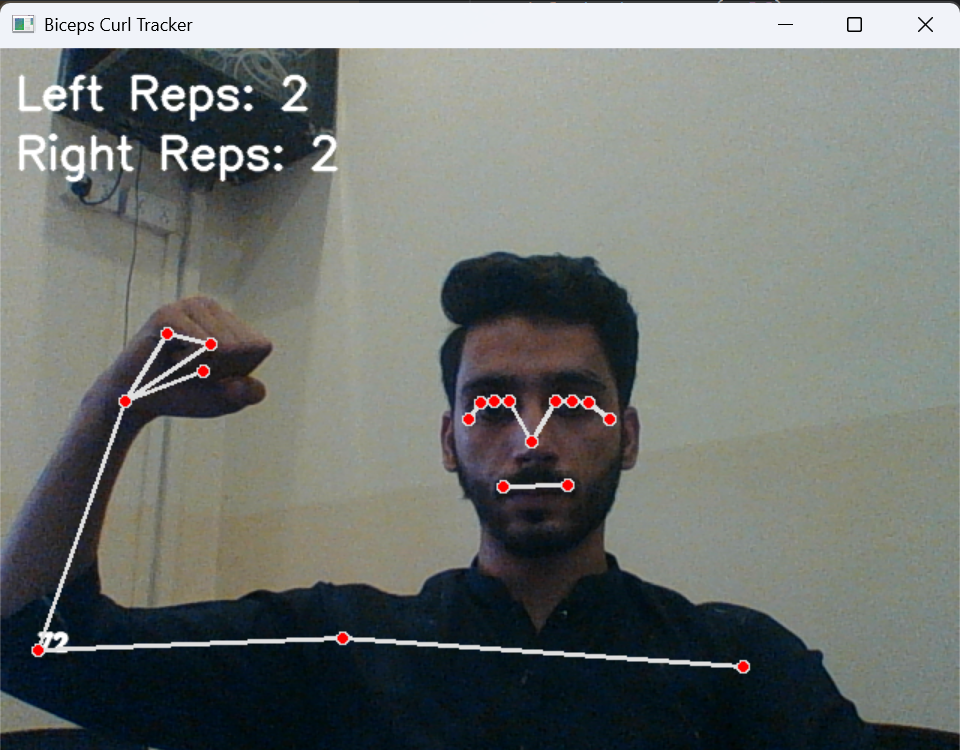
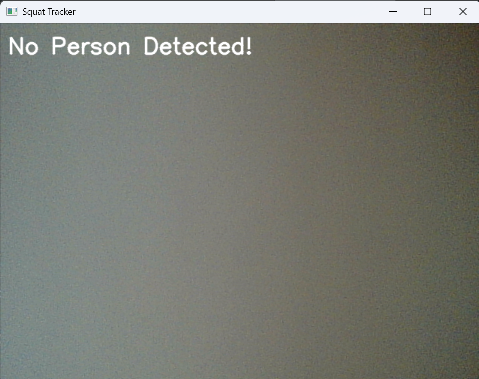
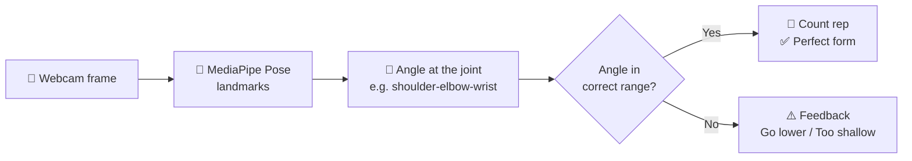

<!-- Posture Tracker · README by Usama Shahid (fewgets) -->
<div align="center">


<p>
  
  
  
  
</p>

</div>

---
## 📌 Overview

**Posture Tracker** is a computer-vision app that helps you **exercise with correct form**. It uses
**MediaPipe Pose** to track your body in real time through the webcam, calculates joint angles,
**counts your reps automatically** and gives **instant feedback** like *"Go Lower!"*, *"Too Shallow!"*
or *"Perfect Form!"*

---

## 📷 Demo

| Bicep Curl Tracking | No Person Detected |
|:-:|:-:|
|  |  |

---

## ✨ Features

- 🎥 **Real-time webcam tracking** with OpenCV
- 🧍 **33-point skeleton overlay** from MediaPipe Pose
- 🏋️ **4 exercises:** bicep curls, squats, push-ups and planks
- 🔢 **Automatic rep counting** based on joint angles
- ✅ **Live form feedback** on screen
- 🚫 **Smart detection:** warns when no person is in frame

---

## 🧠 How It Works



The angle at a joint is calculated from three landmarks. A **rep** is counted when the angle moves
through the full range of the exercise, for example from arm extended (~160°) to fully curled (~30°).

---

## 🚀 Run Locally

```bash
git clone https://github.com/fewgets/Posture-Tracker.git
cd Posture-Tracker

pip install -r requirement.txt      # opencv-python, mediapipe, numpy
python PoseTracker.py
```

- Press **`q`** to quit the exercise window.
- Using a second camera? Change `cv2.VideoCapture(0)` to `cv2.VideoCapture(1)` in `PoseTracker.py`.

---

## 🧰 Tech Stack

| Component | Tool |
|---|---|
| Language | Python 3.10 |
| Computer Vision | OpenCV |
| Pose Estimation | MediaPipe Pose |
| Maths | NumPy |

> 💡 This tracker later became the core of **[FitFusion](https://github.com/fewgets/FitFusion)**, a full AI fitness app with meal planning and progress tracking.

---

## 🤝 Let's Work Together

<div align="center">

**Have an idea, a freelance project, or want to collaborate on something in AI?**
I'm always open to collaborations, freelance work and full-time opportunities.

<a href="mailto:shaikhusama541@gmail.com?subject=Collaboration%20-%20Posture%20Tracker">
  
</a>
<a href="https://www.linkedin.com/in/-usamashahid/">
  
</a>
<a href="https://github.com/fewgets">
  
</a>

<br/><br/>

⭐ **If you like this project, please give it a star. It really helps!** ⭐

<br/>

<h3>"Perfect form beats heavy weight."</h3>


</div>
